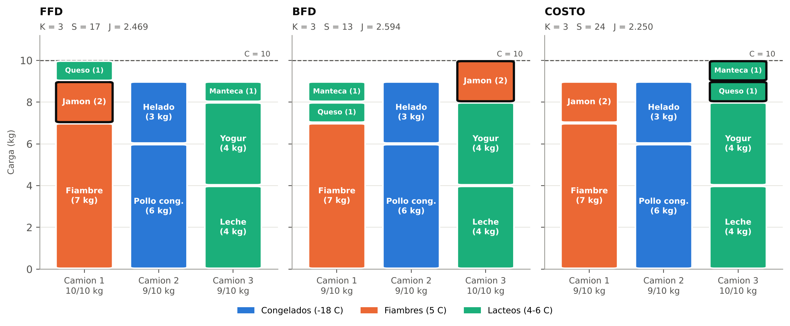
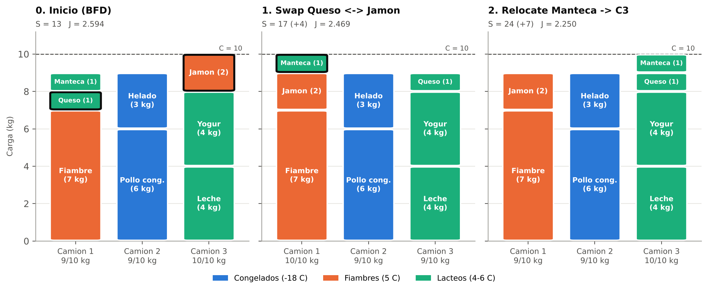

# 2. Algoritmos Implementados

Todos los algoritmos comparten el mismo chequeo de factibilidad: un producto i entra en el camion k si carga(k) + p_i <= C y si el rango [Tmin, Tmax] del camion con i agregado cumple el modo termico (Delta, Bandas o Hibrido). Guardando Tmin y Tmax por camion, el chequeo cuesta O(1). Para ilustrarlos se usa una instancia de 8 productos (C = 10 kg, delta = 4 C) con tres familias: congelados, fiambres y lacteos. La similitud vale 3 dentro de una familia, 1 entre lacteos y fiambres y 0 en el resto (S_max = 32). El optimo es K = 3, S = 24, J = 2.25.

## 2.1 Heuristicas Constructivas

Todas procesan los productos por **peso decreciente**: primero se ubican los pesados, que tienen pocas opciones, y despues los livianos, que se acomodan facilmente en los huecos que quedan.

* **FFD (First-Fit Decreasing):** coloca cada producto en el primer camion factible y abre uno nuevo solo si no entra en ninguno. Es la referencia de eficiencia en flota y no considera la similitud.
* **BFD (Best-Fit Decreasing):** entre los camiones factibles elige el mas cargado (minimo residuo). Llena mejor los camiones, pero tampoco considera la similitud.
* **MOCHILA:** arma un camion por vez. El producto mas pesado que queda es la semilla, y se completa el camion con el subconjunto compatible en temperatura de mayor peso que entra, resuelto como mochila 0/1 por programacion dinamica (pesos en centesimos). Llenar cada camion de forma aislada es miope: los ultimos camiones quedan con productos sobrantes e incompatibles. Esto explica su mayor K en la seccion 3 (70.17 frente a 69.83).
* **COSTO (costo marginal):** evalua cuanto cambia J al agregar i a cada camion factible k, es decir delta_J = -beta * sum_{j en k} s_ij, y abrir un camion cuesta +alpha. Como delta_J <= 0 < alpha, solo abre un camion cuando no queda otra opcion (mismo K que FFD), y entre los factibles elige el de mayor afinidad. Por eso es la constructiva mas cercana al optimo exacto (seccion 4.1: +0.0146 frente a +0.0608).

En el ejemplo (Figura 2.1), las cuatro constructivas logran K = 3, pero solo COSTO agrupa los lacteos. El producto que define la diferencia es el Jamon: FFD lo pone en el primer camion donde entra, BFD en el mas lleno y COSTO donde tiene mas afinidad.

{width=15.5cm}

## 2.2 Operadores de Busqueda Local

Los tres operadores solo aceptan movimientos factibles que bajan J, y se aplican en ciclo hasta que ninguno mejora:

* **Relocate:** mueve un producto i del camion a al camion b. El cambio es delta_J = -alpha * [a queda vacio] - beta * (ganancia - perdida). Se aplica el mejor movimiento (*best improvement*), y si a queda vacio K baja.
* **Swap:** intercambia i (de a) con j (de b) si ambos camiones siguen siendo factibles y la similitud total sube. Se aplica el primero que mejora (*first improvement*). Swap es clave cuando los camiones estan llenos y relocate no tiene lugar para mover nada.
* **Vaciar Camion:** elimina el camion con menos productos y reubica cada uno en el camion factible de mayor afinidad. Si todos entran, K baja en 1 en un solo movimiento.

En el ejemplo (Figura 2.2), a partir de BFD ningun relocate es factible. Swap intercambia Queso y Jamon (+4), lo que libera espacio, y despues relocate mueve la Manteca (+7): se alcanza el optimo.

{width=15.5cm}

## 2.3 Metaheuristica (GRASP)

GRASP parte de FFD + busqueda local, de modo que nunca devuelve algo peor que esa solucion. En cada iteracion:

1. **Construccion aleatorizada:** los productos se recorren por peso decreciente. Para cada uno, los camiones factibles se ordenan por ganancia de similitud y se elige uno al azar entre los k = 3 mejores (lista restringida de candidatos, RCL). Con k = 1 seria COSTO; con k > 1 se generan soluciones distintas en cada iteracion.
2. **Busqueda local:** se aplican los tres operadores hasta llegar a un optimo local.
3. Si la solucion es factible y mejora J, se guarda como la mejor.

La RCL aporta diversidad y la busqueda local, intensificacion. Segun la seccion 5, esta combinacion sube S/S_max de 0.2110 a 0.2560 (+21%) sin agregar camiones, con 100 iteraciones.

## 2.4 Justificacion experimental de las decisiones

Cada eleccion de esta seccion se tomo mirando los resultados de las secciones 1, 3, 4 y 5. La tabla resume que se probo y por que se eligio lo que se eligio.

| Decision | Que se probo | Evidencia | Eleccion |
| ------------------ | ------------------ | -------------------------------------- | -------------------------- |
| Constructiva base | FFD, BFD, MOCHILA, COSTO | FFD/BFD dan el menor K (gap 0.39%); MOCHILA el peor (0.84%); COSTO queda a 0.07 camiones y es la mas cercana al optimo exacto en J (+0.0146 vs +0.0608) | COSTO para calidad, FFD como piso rapido de GRASP |
| Busqueda local | Relocate, Swap, Vaciar | En el ejemplo, sin Swap no hay relocate factible; Vaciar es el unico que baja K en un paso | Los tres en ciclo |
| alpha y beta | alpha en {0.5, 1, 2}, beta en {0.5, 1, 2}/S_max | K y S no cambian en todo el barrido | alpha = 1, beta = 1/S_max (S pesa a lo sumo 1, nunca paga un camion) |
| Modo de temperatura | Delta, Bandas, Hibrido | Mismo K (69.93), J y utilizacion (90.5%); Bandas es el mas rapido (489 ms vs 602 ms de Delta) | Cualquiera es valido; se reporta Delta por ser parametrizable |
| Tolerancia delta | 2 a 12 C | Pasar de delta = 4-6 C a 8-12 C ahorra entre 1 y 2 camiones | delta = 4-6 C: el costo es chico frente al riesgo de cortar la cadena de frio |
| Iteraciones de GRASP | 50, 100, 200, 500 | Con 100 se alcanza el 99.96% de la mejor S en 66 ms; 500 cuadruplica el tiempo | 100 iteraciones |
| Tamano de la RCL | k = 1 (COSTO) vs k = 3 | No se barrio k: con k = 1 la construccion es deterministica y repetir iteraciones no aporta nada; k = 3 da variedad sin alejarse de los mejores camiones | k = 3 (decision de diseno) |

En resumen, el criterio fue siempre el mismo: primero no perder camiones (K manda en J) y, a igual K, quedarse con la opcion que mas similitud agrupa en un tiempo razonable.
